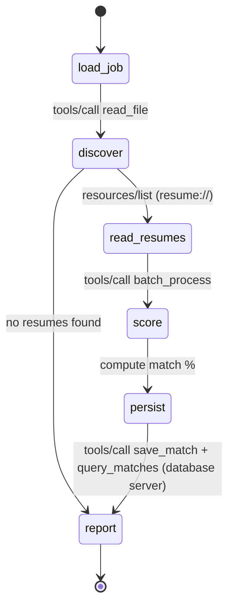

# Resume Matching with MCP

A LangGraph agent that ranks resumes against a job description. All file and
database access goes through MCP servers (JSON-RPC 2.0 over stdio).

## Files
| File | Role |
|---|---|
| mcp_common.py | Shared MCP server core: JSON-RPC 2.0, errors, tools, resources |
| filesystem_mcp_server.py | MCP server: list/read/write, watch_directory, batch_process, resources |
| database_mcp_server.py | Bonus MCP server: SQLite store of match results |
| matching_agent.py | LangGraph agent and MCP client (no file-system code) |
| test_mcp_server.py | Scenario tests for the MCP server |
| config.json | Server configuration (sandbox root, limits) |
| workspace/ | Sandboxed data: jobs/ and resumes/ |

## Setup
    python -m venv .venv && source .venv/bin/activate   # Windows: .venv\Scripts\activate
    pip install -r requirements.txt

## Run
    python -m unittest -v test_mcp_server.py            # MCP server tests
    python matching_agent.py --job backend_engineer.txt --top 5
    python matching_agent.py --job backend_engineer.txt --watch 5   # Ctrl+C to stop

Try it live: copy a new file into workspace/resumes/ while --watch is running.

## Agent workflow (state machine)

## Watch mode sequence
Agent calls watch_directory once (baseline), then repeatedly calls it with
wait_seconds=N. The server blocks until a file is added or modified, then the
agent re-runs the graph.
